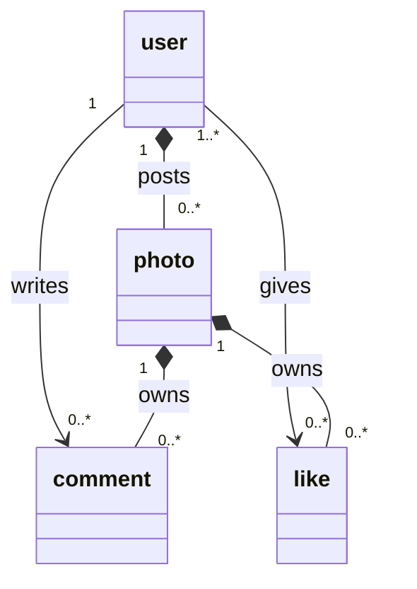

# MULTI TABLE OPERATIONS

## Approach 

1. What are the common features? Likes, comments etc. usually have their own columns
2. What resource types are there? Those usually have tables.
3. Relationships or ownerships of resource types should be reflected in the table design.

Relationships:
1. one-to-many (`1:n`) - user **has many** photos
2. many-to-one (`n:1`) - a photo **has one** user
3. one-to-one (`1:1`) - a company has one CEO
4. many-to-many (`m:n`) - movies and actors



## Keys

### Primary key

- uniquely identifies a row within a table
- doesn't change
- integer or UUID
- usually called `id`

### Foreign key

- a unique identifier to a row in another table
- used by the "many" side
  - user has many photos - photos has `FK` to user
- rows have this if they **belong to** a different record
- usually equal to the owner row's `PK`
- changes on relationship change
- usually called `something_id`

### Usage

```sql
CREATE TABLE users
(
    id       SERIAL PRIMARY KEY,
    username VARCHAR(50)
);

```

- `SERIAL` - not null, auto incrementing integer

```sql
CREATE TABLE photos
(
    id SERIAL PRIMARY KEY,
    url VARCHAR(256),
    user_id INTEGER REFERENCES users(id)
);
```

This allows us to run more advanced queries like:

```sql
SELECT *
FROM photos
WHERE user_id = 1;
```

```sql
SELECT url, username
FROM photos
         JOIN users ON users.id = photos.user_id;
```

### Data consistency

Using `PK` and `FK` helps with the data consistency in our DB, ie:
- inserting
  - inserting a photo belonging to a non-existent user → transaction fails
  - inserting a photo not belonging to anybody (like `NULL`) → transaction succeeds; needs `NON NULL`
- deleting
  - delete a user → dangling `FK` references
    - even if `FK` dangling, they will never reference to a new user again, because `PK` won't repeat
    - but still not ideal in a real world, so we set a policy:
      1. `ON DELETE RESTRICT` (default) - throw error
      2. `ON DELETE NO ACTION` - throw error
      3. `ON DELETE CASCADE` - delete it too
      4. `ON DELETE SET NULL` - set to `NULL`
      5. `ON DELETE SET DEFAULT` - default value, if one is provided

```sql
CREATE TABLE photos
(
    id      SERIAL PRIMARY KEY,
    url     VARCHAR(256),
    user_id INTEGER REFERENCES users (id) ON DELETE CASCADE
);
```

### Deletion

