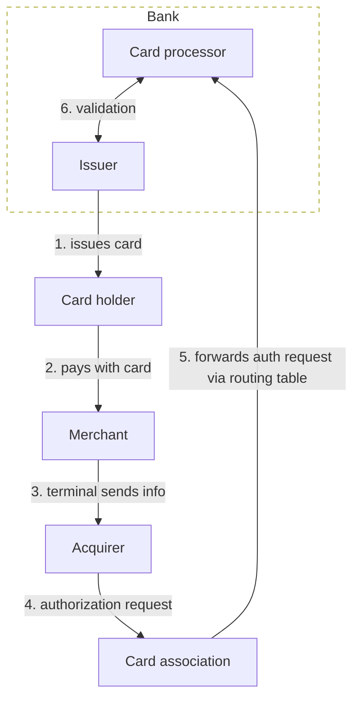
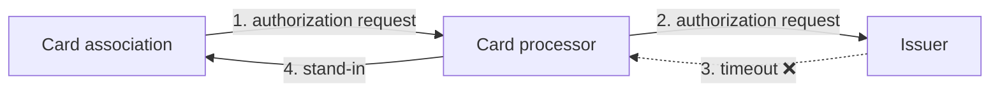

# CARD PAYMENT PROCESS

## Flow

### 1. Authorization flow

1. bank issues the card to a user
2. user pays at a merchant
3. merchant's terminal sends info to the acquirer
4. acquirer sends the **authorization request** to the card association
   - includes PAN (primary account number)
5. card association sends the auth request to the bank via card processor
   - which bank? check via **routing table** + BIN (bank identification number) (first 8 numbers of PAN)
6. bank validates
   - card exists? within daily limit? enough money?
   - creates a **hold**

### 2. Clearing

1. successful authorization creates a **hold**
   - money is blocked - available balance (disponibilní zůstatek) decreases
2. hold lasts up to 30 days for clearing
3. if cleared, it becomes a real transaction
   - hold is released
   - ledger balance (účetní zůstatek) evens out with available balance
4. over 30 days? Hold is released, balance recovers

## 3. Settlement

1. issuer pays the card association
2. the card association pays the acquirer
3. the acquirer pays the merchant

## Other

### Card processor

Tech infrastructure for card payments. Banks usually don't want to implement connection to card associations - reuse existing solutions.

Features:
- direct connection to card associations
- manufacture and distribution of cards
- 3DS
- etc.

### Offline authorization

- can be done at the card level or terminal level
- when?
  - small amounts (public transport, parking etc)
  - offline (airplane, mountains)
  - fallback
- potential issues:
  - bank - user has no money
  - merchant - **chargeback** (*don't have money, sorry, merchant*); more chargebacks means more fees for the merchant

### Chargeback

- transaction dispute
- must be done within 120 days
- common reasons include failure to deliver goods, scams, ATM doesn't give cash etc.

1. user disputes a transaction
2. bank checks whether the dispute has substance
3. start the chargeback process with the card association
4. the merchant gets notified
   - merchant accepts - user gets money back
   - merchant rejects and ideally provides proof - arbitrage; card association steps in

### STIP (stand-in processing)

The card processor can be the stand-in for us in the authorization flow.
Can happen if the issuer experiences a timeout.

## Authorization messages