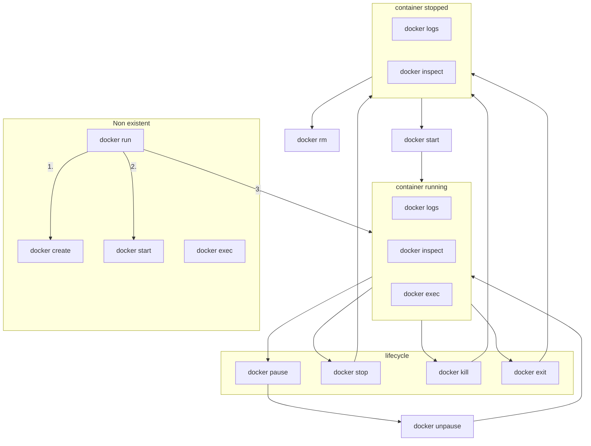

# CONTAINERS

**Images** are read-only self-contained templates that has everything the app needs to run.

**Containers** are running instances of images.

## Anatomy

1. Base layer - a Linux distro, like Alpine (minimal) or Ubuntu (more complex)
2. Runtime environment - whatever the app needs, like Python or Node.js
3. Libraries, dependencies - external code the app relies on
4. Application code - our app code or binaries
5. Configuration - Docker config like environment

## Basic commands

- `docker --help`
- `docker pull nginx`
- `docker run nginx`
    - `-d` (`docker run -d nginx`) - detached mode
    - `-p` (`docker run -p 8080:80 nginx`) - port
        - can verify with `curl http://localhost:8080` or visiting that on our browser
    - `--name ourName`
- `docker ps`
    - we can refer to specific images via the generated name
    - can add `--filter name=web_server`- containers containing `web_server` in the name
- `docker logs`
    - `docker logs -f name` - follow mode
- `docker exec`
    - executes a command
    - `docker exec -it name /bin/bash`
- `docker kill docker_name` - kills the container
- `docker stop docker_name` - gracefully shuts down the container
    - `docker stop $(docker ps -q)`
        - takes output from `docker ps-q` - quiet, so IDs only
        - then stops them all
- `docker build`
    - builds a container from an image

## Lifecycle

1. `docker run <image>`
- in actuality, it's `docker create` + `docker start`
2. container running
    - `logs`, `inspect`, `exec`
    - lifecycle commands:
        1. `pause <cId>` - keep memory contents; `unpause`
        2. `stop <cId>` - gracefully stops, clear memory
        3. `kill <cId>` - forcefully stops, `SIGKILL`
        4. `exit <num>` - number for error, `0` otherwise
3. container stopped
    - can be seen via `ps -a`
    - `logs`, `inspect`
    - `rm` - remove the container

