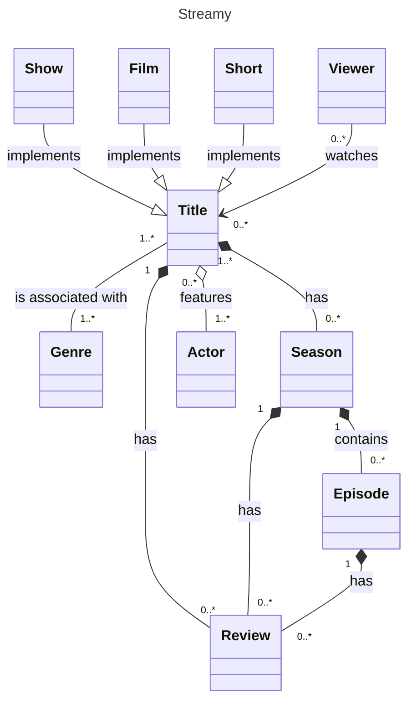

# CLASS DIAGRAMS

## Basics

Used to represent **relationships** between **entities**.

- *entity* - a noun within a business

### Relationships

There are three:
1. association
   - entities *can survive* without each other (have their own lifecycles)
   - *no owner*, instead one *uses* the other
   - `Title -- Genre` or `Teacher -- Student`
   - directional: `Viewer --> Title` meaning viewer holds reference to the title, not the other way around
2. aggregation
    - a child can *meaningfully* exist without the parent (the child has meaning outside the parent)
    - parent owns the child
    - `Title o-- Actor` or `Class o-- Teacher`
3. composition
   - child cannot exist without the parent
   - parent owns the child
   - `Title *-- Season` or `Class *-- Grade`

## Inheritance

- inheritance (*generalization*): `Show --|> Title`
- interface (*realization*): `Implementation __|> Interface`

## Labels

### Title
```
---
title: Streamy
---
```

### Descriptions

- describes the relationship
- directionality matters
   - directional: we end with the arrow side
   - non-directional: the relationship must work both ways
- `Title -- Genre: is associated with` or `Show --|> Title: implements`

### Multiplicity

- aka *cardinality*
- describes the amount
- description is directional
- `Title "1..*" -- "0..*" Seasons`: title *zero to many* seasons; season belongs to *one to many* titles

## Extra

- inner text: `Title: some text` (must be after the first `Title`)
- links:
   - `link Title "https://www.netflix.com/cz-en/title/80234304" _blank`
      - `_blank` is CSS and means open in new tab



