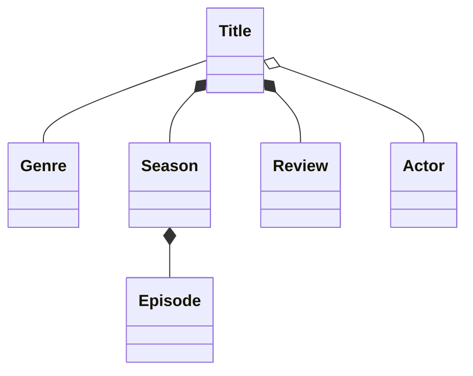

# DOMAIN BASICS

We can use `classDiagram`.

Model the **relationships** between **entities**.

- *entity* - a noun within a business

### Relationships

There are three:
1. association
   - entities *can survive* without each other (have their own lifecycles)
   - *no owner*, instead one *uses* the other
   - `Title -- Genre` or `Teacher -- Student`
   - directional: `Viewer --> Title` meaning viewer holds reference to the title, not the other way around
2. aggregation
    - a child can *meaningfully* exist without the parent (the child has meaning outside the parent)
    - parent owns the child
    - `Title o-- Actor` or `Class o-- Teacher`
3. composition
   - child cannot exist without the parent
   - parent owns the child
   - `Title *-- Season` or `Class *-- Grade`

