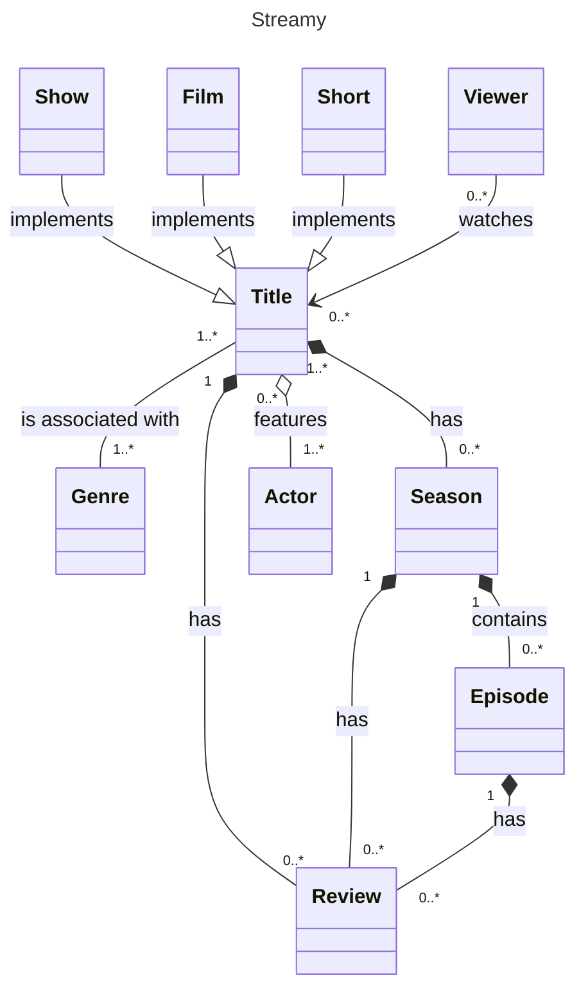

# ADVANCED DOMAIN

## Inheritance

- aka *generalization*
- `Show --|> Title`

## Labels

### Title
```
---
title: Streamy
---
```

### Descriptions

- describes the relationship
- directionality matters
  - directional: we end with the arrow side
  - non-directional: the relationship must work both ways
- `Title -- Genre: is associated with` or `Show --|> Title: implements`

### Multiplicity

- aka *cardinality*
- describes the amount
- description is directional
- `Title "1..*" -- "0..*" Seasons`: title *zero to many* seasons; season belongs to *one to many* titles  

## Extra

- inner text: `Title: some text` (must be after the first `Title`)
- links:
  - `link Title "https://www.netflix.com/cz-en/title/80234304" _blank`
    - `_blank` is CSS and means open in new tab


