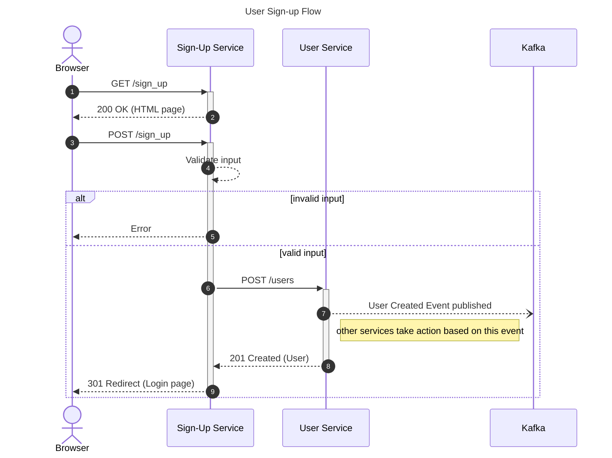

# SEQUENCE DIAGRAMS

Used for flows.

- `sequenceDiagram`
  - can add `autonumber`

## Basics

- `actor` - represented as a stick figure
- `participant`
- messages:
  - interactions between nodes
  - types:
    - `->>` - synchronous request
    - `--)` - asynchronous request (sender doesn't wait)
    - `-->>` - response
    - `--x` - lost message
    - `Browser ->> Sign-Up Service: GET /sign_up` and `Sign-Up Service -->> Browser: 200 OK (HTML)` 

### Branching

```
alt branch 1
    signup -->> browser: Error
else branch 2
    signup ->> userService: POST /users
    userService -->> signup: 201 Created (User)
    signup -->> browser: 301 Redirect (Login page)
else branch 3
    A ->> B
end
```

## More info

### Activation

- used to indicate the length of the interaction
- `+` to activate, `-` to deactivate

```
browser ->>+ signup: GET /sign_up
signup -->>- browser: 200 OK (HTML page)
```

### Notes

- labels should be kept minimal
- `Note [Left|Right] of [Node]: label content`
- `Note over node1, node2: label that spans across multiple nodes`

